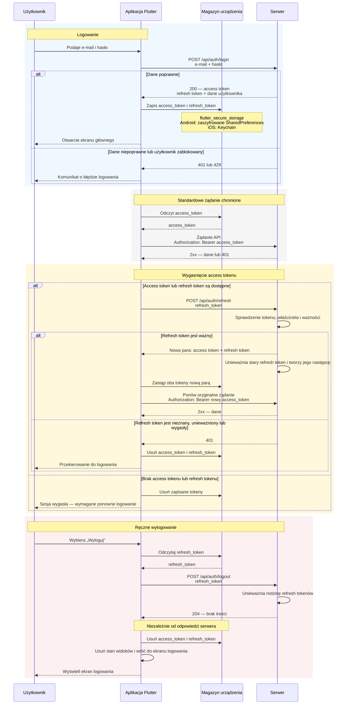

# Raport — przebieg sesji i logowania

## Diagram sekwencji

## Podsumowanie danych sesji

- **Dane logowania:** e-mail i hasło; hasło nie jest zapisywane na urządzeniu.
- **Z serwera po logowaniu:** access token, refresh token oraz dane użytkownika.
- **Magazyn urządzenia:** oba tokeny przechowuje `flutter_secure_storage`.
  Android używa zaszyfrowanych SharedPreferences, a iOS Keychain z dostępnością
  `unlocked_this_device`.
- **Identyfikacja żądań:** chronione żądania wysyłają nagłówek
  `Authorization: Bearer <access token>`.
- **Access token:** ważny domyślnie 15 minut.
- **Refresh token:** ważny domyślnie 14 dni; przy odświeżeniu odbywa się rotacja
  — stary token jest unieważniany, a serwer zwraca nową parę.
- **Logowanie zewnętrzne:** aplikacja nie korzysta obecnie z zewnętrznego
  dostawcy tożsamości; przepływ opiera się na koncie e-mail i hasło.
